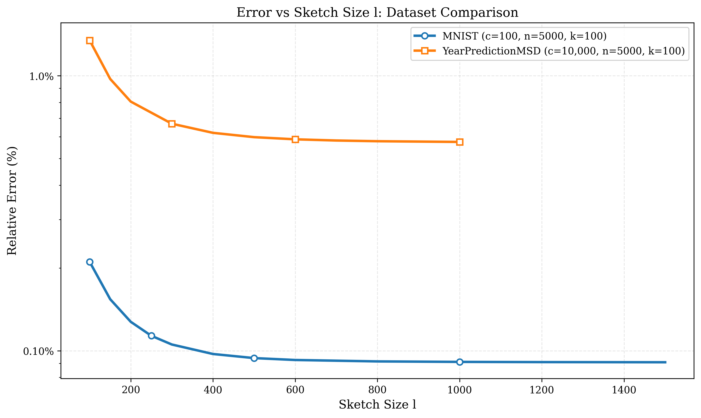
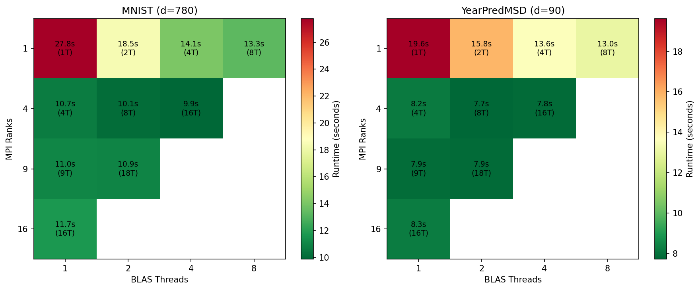

# Randomized Nyström Low-Rank Approximation with MPI

A distributed implementation of the randomized Nyström method for approximating large dense kernel matrices, written in Python with `mpi4py` and NumPy. It runs on a 2D grid of MPI processes, never forms the full kernel matrix, and was benchmarked on MNIST and YearPredictionMSD.

Authors: Thies Weel and Emanuele Lovino. HPC course project, Sorbonne Université, January 2026. The written report received the maximum grade.

## Problem

Given a symmetric positive semidefinite matrix $A \in \mathbb{R}^{n \times n}$ (here a Gaussian RBF kernel $A_{ij} = \exp(-\|x_i - x_j\|^2 / \sigma^2)$) and a random sketch $\Omega \in \mathbb{R}^{n \times \ell}$, the Nyström approximation is

$$A_{\text{Nyst}} = (A\Omega)\,(\Omega^\top A \Omega)^{+}\,(A\Omega)^\top,$$

followed by a rank-$k$ truncation $[\![A_{\text{Nyst}}]\!]_k$. Accuracy is measured with the relative nuclear-norm error $\|A - [\![A_{\text{Nyst}}]\!]_k\|_* / \|A\|_*$.

## What is implemented

- **2D block distribution** over a $\sqrt{P} \times \sqrt{P}$ process grid, with row and column sub-communicators (`nystrom.py`).
- **Matrix-free streaming:** each process builds its kernel block on the fly and multiplies it with its slice of $\Omega$, so per-process memory drops from $O(n^2/P)$ to $O(n\ell/P)$ (`data/kernel.py`).
- **Cache-blocked kernel construction** to keep the distance computation in cache.
- **Two sketching matrices:** Gaussian and the Subsampled Randomized Hadamard Transform (SRHT) (`data/sketch.py`).
- **Pipeline:** $Y = A\Omega$ (distributed), $B = \Omega^\top Y$ (Allreduce), pseudoinverse via SVD, then rank-$k$ truncation. A non-blocking variant overlaps communication with computation.
- **Experiments:** spectral decay, error versus sketch size $\ell$ and rank $k$, kernel-width sensitivity, memory scaling, runtime versus $n$, and an MPI-ranks × BLAS-threads grid.

## Selected results

Error against sketch size: the error saturates at around $\ell \approx 600$, so a larger sketch adds cost without improving accuracy.



Hybrid MPI × BLAS scaling on 8 cores, MNIST, $n = 20{,}000$, $\ell = 500$, $k = 100$ (`optimized_experiment_results.json`):

| MPI ranks | BLAS threads | Runtime (s) | Memory per rank (MB) |
|---|---|---|---|
| 1 | 1 | 27.8 | 3052 |
| 1 | 8 | 13.3 | 3052 |
| 4 | 1 | 10.7 | 763 |
| 4 | 4 | 9.9 | 763 |
| 9 | 1 | 11.0 | 339 |
| 16 | 1 | 11.7 | 191 |

Strong scaling is best at $P = 4$. Beyond that, communication and the serial small-matrix steps dominate, while memory per rank keeps falling as $1/P$.



## Repository layout

```
main.py                 entry point (MPI grid setup, experiment driver)
nystrom.py              distributed Nyström pipeline, error estimates, scaling analysis
data/kernel.py          RBF kernel blocks (naive, cache-blocked, chunked/streaming)
data/sketch.py          Gaussian and SRHT sketching matrices
data/libsvm_loader.py   reader for LIBSVM-format datasets
scaling_analysis.py     MPI × BLAS heatmap
plots/                  plotting scripts and the JSON results they read
figures/                generated figures
```

## Running

Requirements: Python 3, NumPy, mpi4py, matplotlib, and an MPI implementation (e.g. OpenMPI). The process count must be a perfect square.

```bash
pip install numpy mpi4py matplotlib
mpirun -n 4 python main.py --dataset synthetic --n 1000
mpirun -n 4 python main.py --dataset mnist --n 20000 --use-cache-blocking
```

Datasets are not included. Download MNIST and YearPredictionMSD in LIBSVM format from the [LIBSVM datasets page](https://www.csie.ntu.edu.tw/~cjlin/libsvmtools/datasets/) into `data/datasets/`.

To regenerate the figures:

```bash
cd plots && python generate_all_figures.py
```

## Reference

J. A. Tropp, A. Yurtsever, M. Udell, V. Cevher. *Fixed-Rank Approximation of a Positive-Semidefinite Matrix from Streaming Data.* NeurIPS 2017.
